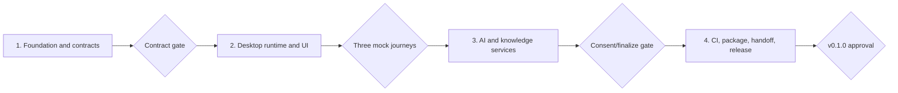

# BambooWorkbench Implementation Roadmap

**Goal:** Coordinate the four executable plans without duplicating their task-level instructions.

**Canonical project root:** `D:\Project\BambooWorkbench`

**Approved product identity:** `BambooWorkbench` / `竹简工作台` / `湖大智竹实践团队`

## Source of Truth

- Product scope and decisions: [`../specs/2026-07-12-bamboo-workbench-framework-design.md`](../specs/2026-07-12-bamboo-workbench-framework-design.md)
- Plan 1: [`2026-07-13-bamboo-workbench-01-foundation-contracts.md`](2026-07-13-bamboo-workbench-01-foundation-contracts.md)
- Plan 2: [`2026-07-13-bamboo-workbench-02-desktop-runtime-ui.md`](2026-07-13-bamboo-workbench-02-desktop-runtime-ui.md)
- Plan 3: [`2026-07-13-bamboo-workbench-03-ai-knowledge.md`](2026-07-13-bamboo-workbench-03-ai-knowledge.md)
- Plan 4: [`2026-07-13-bamboo-workbench-04-packaging-release.md`](2026-07-13-bamboo-workbench-04-packaging-release.md)

If this roadmap and a child plan differ, the specification controls product intent and the child plan controls implementation steps.

## Fixed Execution Order

1. Plan 1 freezes Pydantic contracts, generated JSON Schema, the validator, and three mock modules.
2. Plan 2 builds the local paths/database, module process boundary, task lifecycle, confirmation flow, and approved PySide6 interface.
3. Plan 3 adds knowledge-first shared services, redaction, consent audit, credential isolation, and offline/optional online AI.
4. Plan 4 adds GitHub collaboration, CI, portable/installer builds, executable member handoff, customer demo, and release controls.

Do not start a later plan until the previous plan’s completion gate passes and its checkpoint is reviewed.

## Scope Boundaries

The first framework release includes:

- one local Windows desktop program with no login;
- three switchable module entries under one shell;
- three contract-compliant mock modules;
- local file intake, task progress, cancellation, confirmation, results, history, settings, logs, and diagnostics;
- shared mock AI and knowledge services with the real API boundary available but off by default;
- a private-GitHub collaboration structure and module acceptance process;
- a portable build and per-user Windows installer.

It deliberately excludes:

- moisture, boiling, and after-sales business algorithms or Excel rules;
- production vector retrieval and autonomous rule learning;
- cloud accounts, remote databases, multi-user access, and login;
- macOS packaging in v0.1.0;
- a customer-facing plugin marketplace or module installer.

## Framework/Module Ownership Contract

| Area | Framework lead | Module members |
|---|---:|---:|
| PySide6 UI and visual system | Owns | No edits |
| Module JSON contracts and validator | Owns/freeze | Consumes |
| Process lifecycle, history, confirmation, AI/knowledge gateway | Owns | Requests through contracts |
| Business Excel parsing, calculation, judgment, charts, advice | Does not implement | Owns per module |
| Module fixtures and expected business outputs | Reviews integration | Owns and anonymizes |
| Installer, demo, integration acceptance | Owns | Supplies module evidence |

Branches after contract freeze:

- `main`: protected, demonstrable releases only;
- `integration`: framework work and combined acceptance;
- `module/moisture`: moisture owner;
- `module/boiling`: boiling owner;
- `module/after-sales`: after-sales owner.

Every module branch starts from the same frozen `integration` commit and returns through a PR to `integration`, never directly to `main`.

## Checkpoints and Evidence

| Checkpoint | Required evidence | User decision |
|---|---|---|
| 0. Plan approval | Four plans reviewed; project root and scope correct | Choose execution mode and authorize coding |
| 1. Contract freeze | Schema export stable; validator and three mock packages pass | Authorize module branches |
| 2. Desktop framework | Three mock journeys, confirmation, cancellation, history, fault isolation pass | Approve UI/framework baseline |
| 3. Shared services | Knowledge priority, mock AI, refusal, redaction, consent audit, finalize pass | Approve AI boundary |
| 4. GitHub setup | Private repo, collaborators, protected `main`, CI required | Approve remote mutations |
| 5. Packaging | Portable and installer smoke; upgrade/uninstall preserve local data | Approve trial build |
| 6. Customer handoff | Module guides verified; demo and acceptance record prepared | Approve customer demonstration |
| 7. Release | Clean-machine test, green CI, checklist and known limitations reviewed | Approve PR merge, tag, and private release |

## Information That May Be Supplied Later

These items do not block local implementation through the mock-service checkpoint:

- the authenticated GitHub account and three collaborator usernames;
- actual module packages and their anonymized acceptance fixtures;
- the chosen OpenAI-compatible provider, base URL, model, and temporary test credential;
- installer publisher/signing identity;
- customer trial machine details and feedback date.

When any item becomes necessary, stop at the relevant checkpoint instead of inventing it.

## Execution Choice After Approval

Use one of the execution modes required by the child-plan headers:

1. **Subagent-Driven Development (recommended):** one fresh worker per task plus review checkpoints; use only after the user explicitly authorizes subagents.
2. **Inline Execution:** execute the plans sequentially in this task with the same TDD and checkpoint requirements.

Regardless of mode, never perform GitHub remote mutations, publish a release, or use a real API credential without the explicit approval stated in Plan 4.
