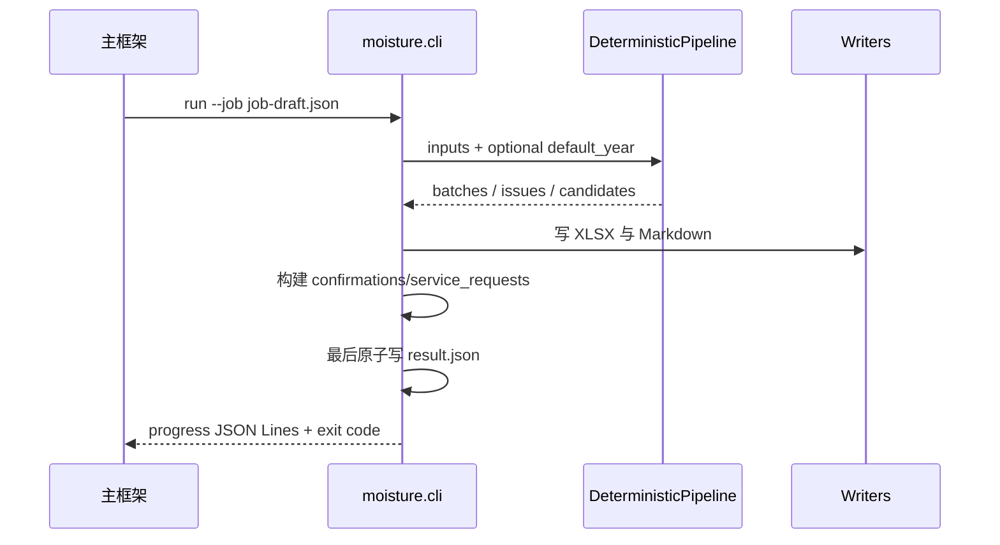

# 竹丝水分模块完整架构

## 1. 文档定位

本文描述 BambooWorkbench 竹丝水分模块 `moisture` v0.1.0 的当前实现架构。模块不是独立桌面应用，也不承担主框架的身份、数据库、网络 Provider 或 UI 职责；它是一个由主框架通过进程合同调用的离线业务模块。

当前实现基于旧业务稳定提交 `d98433b` 选择性迁移公式、统计、Excel 解析、规则评估、经验检索、XLSX/Markdown 报告和 AI 响应校验。CLI、合同映射、draft/finalize、service request 和主框架进程适配为新模块边界。

## 2. 系统上下文

```mermaid
flowchart LR
    U["用户 / 主框架 UI"] --> TS["TaskService"]
    TS --> SS["输入快照与任务目录"]
    SS --> J["JobRequest / job.json"]
    J --> REG["ModuleRegistry"]
    REG --> RUN["ModuleProcessRunner"]
    RUN --> BAT["modules/moisture/run_module.bat"]
    BAT --> CLI["moisture.cli"]
    CLI --> D["draft_orchestrator"]
    CLI --> F["finalize_orchestrator"]
    D --> OUT["result.json + XLSX + Markdown"]
    F --> OUT
    D --> SR["confirmations / service_requests"]
    SR --> HOST["主框架确认、Knowledge、AI 编排"]
    HOST --> RESP["confirmation / service-response 文件"]
    RESP --> F
```



主框架和模块之间只通过文件、stdout JSON Lines、stderr 和退出码通信。模块不依赖主框架进程内存，不直接访问主框架数据库。

## 3. 部署与入口

| 项目 | 当前值 |
|---|---|
| 模块 ID | `moisture` |
| 版本 | `0.1.0` |
| Manifest | `module.json` |
| 入口 | `run_module.bat` |
| Python 包 | `src/moisture/` |
| 输入扩展名 | `.xlsx` |
| 单文件/批次 | 均支持 |
| 增量运行 | 不支持 |
| 网络要求 | `false` |

`run_module.bat` 的解释器选择顺序为：

1. `BAMBOO_MODULE_PYTHON`；
2. 已激活 `VIRTUAL_ENV`；
3. BambooWorkbench 仓库 `.venv`；
4. 模块本地 `.venv`。

启动器不会从 PATH 盲选系统 Python。所有开发和测试命令必须显式使用仓库 `\.venv\Scripts\python.exe`。

## 4. 目录与职责

```text
modules/moisture/
├── module.json                 主框架 Manifest
├── run_module.bat              Windows 进程入口
├── requirements.txt            锁定范围的运行依赖
├── pyproject.toml               Python 包元数据
├── schemas/                     官方合同 Schema 副本与锁
├── rules/active/                只读运行时规则包
├── experience/                 运行时 approved 经验及离线治理文件
├── samples/protocol/            脱敏协议示例
├── templates/                   Markdown 报告模板
├── tools/                       合同同步工具
├── src/moisture/
│   ├── cli.py                   version/self-check/run 命令
│   ├── contract/                Job/Result/确认/服务响应合同适配
│   ├── domain/                  公式、统计、规则、业务模型
│   ├── adapters/                Excel、规则、经验实现
│   ├── application/             draft/finalize 与请求/响应编排
│   ├── reporting/               XLSX、Markdown、输出校验
│   ├── infrastructure/          hash、路径、完整性、原子写入
│   ├── ports/                   窄接口定义
│   └── tools/                   离线经验管理 CLI
├── tests/                       unit/contract/integration/framework/acceptance
└── docs/                        业务、架构、验收和迁移证据
```

## 5. 分层架构

| 层 | 主要组件 | 职责 | 不承担的职责 |
|---|---|---|---|
| 进程入口 | `run_module.bat`、`cli.py` | 选择受控 Python、解析命令、读取 Job | 安装依赖、调用网络 |
| 合同适配 | `contract/*` | 校验 Job、确认、服务响应，映射正式 Result | 修改官方 Schema |
| 应用编排 | `draft_orchestrator.py`、`finalize_orchestrator.py` | 调用确定性管线、生成请求、写 artifacts | 保存隐藏会话状态 |
| 领域 | `domain/*` | 水分公式、统计、规则与复核状态 | UI、数据库、Provider |
| 适配器 | `adapters/*` | Excel、规则包、经验库落地实现 | 主框架生命周期 |
| 报告 | `reporting/*` | 五表 XLSX、图表、Markdown | 正式责任结论 |
| 基础设施 | `infrastructure/*` | SHA-256、去重、路径、输入完整性、原子写 | 在线存储 |

依赖方向保持为应用层依赖领域和 ports，adapters 实现 ports。正式运行入口不能 import 经验管理端。

## 6. 确定性业务管线

`DeterministicPipeline` 对输入按顺序执行：

1. 跳过 `~$*.xlsx` Office 临时文件；
2. 计算内容 SHA-256，并按内容指纹去重；
3. `FileIntegrityGuard` 在解析前后复核输入未改变；
4. 动态识别工作表、表头和 1—10 个有效样本；
5. 读取供应商、材料、到货/检测日期、总重、部门和质量数据；
6. 独立复算含水率，使用既有 `0.0001` 容差判断公式一致性；
7. 计算均值、极值、区间、标准差、中位数、四分位数及部门差；
8. 加载只读规则包并评估已批准且适用的规则；
9. 保留经验引用字段，供受控的经验检索结果附加；
10. 形成批次、异常、候选、文件结果和错误列表。

单个损坏文件只影响自身。批次可形成 `success`、`partial_success` 或 `failed`，不会因为单文件错误丢弃其他成功结果。

### 6.1 历史月度 Excel 兼容

当前兼容以下旧格式：

- 标题形如“某供应方原竹丝水分检测”或“某供应方竹丝水分检测”；
- “到货时间”作为到货日期别名；
- 只有月日的日期可使用 `module_config_file` 中的 `default_year`；
- 未配置时，可从仍保留的严格父目录名（如 `2026年4月份`）推断年份；
- 多个冲突年份会拒绝处理，不使用当前年份或文件修改时间猜测。

主框架 TaskService 快照会改变父目录，相关集成限制见《08-负责人交接要点.md》。

## 7. draft 流程



draft 可能产生：

- 真实业务 confirmations；
- 至多一个 Knowledge request；
- 至多一个 AI request；
- 确定性 XLSX、Markdown 和 result。

确认和 request ID 基于 root job ID、文件内容指纹、字段、候选、规则 hash 等稳定数据，不依赖 UUID、时间、绝对路径或 finalize job ID。

## 8. finalize 流程

finalize 是新的独立进程：

1. 当前 result 使用 finalize 自身 `job_id`；
2. 使用 `parent_job_id` 作为 root identity；
3. 从当前输入重新运行完整确定性管线；
4. 不读取 draft 输出目录、不依赖前一进程内存；
5. 重建相同 confirmation/request ID；
6. 严格校验确认答案、候选值、类型和批量应用语义；
7. 严格绑定服务 response 的 request、candidate、direction、field、value、rule hash、confidence 和 evidence；
8. 合法证据才可升级复核显示状态；无效、拒绝、错误、超时或缺失响应安全降级；
9. 最终结果中的 confirmations 和 service_requests 均为空。

## 9. 规则与颜色

运行时规则位于 `rules/active/`，由 `RulePackageLoader` 只读加载并校验 Schema、内容 hash、来源、版本和批准状态。

当前默认高/低阈值 `0.55/0.47` 已于 2026-07-17 批准为 `confirmed` 筛查规则，
材料范围为“竹丝/原竹丝”。命中规则可自动显示橙/绿，但颜色不是正式错误、
不合格、责任或处置结论。

颜色语义：

| 颜色 | 含义 |
|---|---|
| 橙/绿 | 已批准确定性规则产生的高/低疑似初筛 |
| 红/蓝 | 严格校验的 AI 辅助证据支持的高/低高度疑似 |
| 无颜色 | 无已批准适用规则命中，或服务证据不足 |

任何颜色都不是正式错误、不合格或责任归属结论。

## 10. 经验库架构

经验库分为两个隔离边界：

### 10.1 正式运行时

`LocalApprovedExperienceRepository` 提供只读查询实现，查询时只返回：

- `approved` 状态；
- 在有效期内；
- scope 与供应商、材料、季节、指标匹配；
- manifest hash、Schema 和治理关系合法。

正式运行边界只允许读取经验库。不过当前 `DeterministicPipeline`、draft 和 finalize 尚未实例化该 repository，现有 approved 经验不会自动附加到批次、报告或 AI 候选。运行时接线必须保持只读，并作为独立任务补充端到端测试，不能把离线管理端接入正式任务。

### 10.2 离线管理端

`LocalEditableExperienceRepository`、`ExperienceManagementService` 和 `moisture.tools.manage_experience` 支持：

```text
list / show / validate / create / update / publish / retire
```

生命周期为 `draft → approved → retired`。管理端实施版本冲突、expected hash、Schema、路径越界、原子写入和历史保留，但没有 Web、登录、多人审批或在线发布平台。

## 11. Knowledge 与 AI 边界

模块只声明正式 `service_requests`，不直接调用服务：

- Knowledge：优先 `moisture` scope，其次 `shared`；未授权 scope 不请求；
- AI：最多 50 个稳定排序候选，规范化 payload 不超过 65,536 UTF-8 字节；
- AI payload 不含完整 Excel、原始行、绝对路径、客户或供应商身份；
- AI request 必须 `requires_user_consent=true`；
- 模块不持有 Provider、HTTP 客户端、API Key 或重试逻辑。

主框架当前默认使用 `MockProvider`。是否接入真实 API 是主框架和安全负责人的职责。

## 12. 输出与原子性

成功或部分成功任务可生成：

- `moisture_summary.xlsx`：竹丝含水率统计、异常分析明细、趋势分析、来源追溯、模型分析记录五张表；
- `analysis_report.md`：业务摘要、规则状态、经验引用、AI 声明和错误说明；
- `result.json`：正式机器合同结果。

XLSX 包含按检测日期排序的来料平均含水率图、总体趋势线和区间值趋势图。artifact 先写临时文件并完成校验，再以 `os.replace` 原子发布；`result.json` 最后原子写入。写入失败的 artifact 不登记为正式输出。

## 13. 安全与故障隔离

模块实施：

- output_dir containment 与路径越界拒绝；
- 输入读取前后 SHA-256 完整性验证；
- 临时文件、重复文件和坏文件隔离；
- stdout 只允许进度 JSON，普通日志和诊断写 stderr；
- 超时、取消、进程失败不写伪成功 result；
- 无 FastAPI、Uvicorn、Web、身份、Session、Cookie、CSRF、数据库、HTTPX、Provider、API Key 和网络发布服务。

## 14. 测试架构

| 测试层 | 重点 |
|---|---|
| unit | 公式、统计、规则、经验、请求构建、响应校验 |
| contract | Manifest、CLI、Schema lock、禁止依赖、管理边界 |
| integration | Excel、批次、draft/finalize、报告、降级 |
| framework | Registry、Runner、TaskService、路径、超时、取消 |
| acceptance | 脱敏业务样本、公式关键值、报告标记和协议示例 |

截至当前提交，模块测试为 `271 passed`；仓库门禁为 `307 passed, 8 skipped`。跳过项为当前 Windows 环境缺少创建 symlink 的权限。

## 15. 常用验证命令

从 BambooWorkbench 仓库根目录执行：

```powershell
.\.venv\Scripts\python.exe -c "import sys; print(sys.executable); print(sys.version)"
.\.venv\Scripts\python.exe -m pytest --version
.\.venv\Scripts\python.exe -m app.tools.module_contract_cli validate modules/moisture
.\.venv\Scripts\python.exe -m pytest modules\moisture\tests -q
powershell -ExecutionPolicy Bypass -File scripts\verify_repo.ps1
```

普通 `.\.venv\Scripts\python.exe -m app` 默认使用 Mock 模块；正式模块启动、部署和 GUI 集成限制见交接文档。
