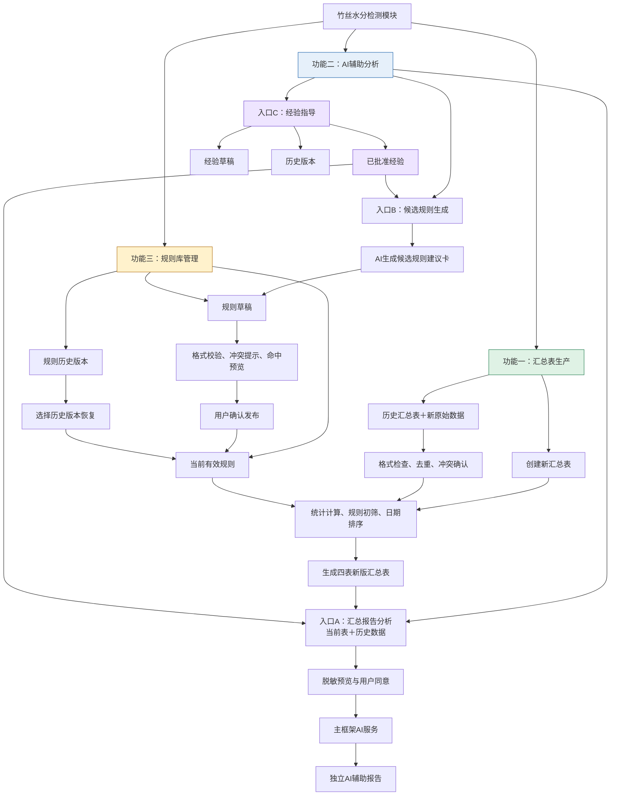

# BambooWorkbench `moisture` 三功能简化架构

> 文档状态：分阶段实施中（v1.1.1 模块已公开历史、经验、规则和规则身份进程合同；中央框架适配待统一 FCR 复验）
> 当前实现基线：`modules/moisture` v1.1.1
> 已交付基础：四表确定性汇总、独立 AI 报告、历史追加和模块侧轻量治理
> 更新日期：2026-07-24
> 本文取代旧“治理工作器＋冻结数据集＋全量回放＋人工复核中心”方案。

## 1. 目标与边界

下一阶段只建设三个面向业务人员的功能：

1. 汇总表生产；
2. AI辅助分析；
3. 规则库管理。

现有含水率公式、Decimal计算、Excel解析、四张业务工作表内容、规则Evaluator、经验库生命周期和主框架AI Provider继续复用，不重新设计业务算法。v1.0.1删除“模型分析记录”工作表，并停止普通汇总任务中的AI辅助复判。

中央 `JobRequest`、`ModuleResult`、Confirmation、Service Request/Response Schema保持不变。模块仍不持有HTTP客户端、Provider、API Key或框架数据库访问能力。

当前 v1.1.1 已具备四表输出、独立 AI 报告、历史追加、经验三栏治理、规则三栏治理、
当前规则身份查询和固定规则快照。管理能力已经接入模块公开 BAT/Schema；中央框架仍需
按统一 FCR 完成合同发现、Runner/TaskService 和 GUI 复验，因此不得描述为客户 GUI
已经可用。候选规则生成仍未实现。

## 2. 总体架构



核心数据流为：

```text
原始数据 → 确定性汇总表 → AI辅助分析或候选规则
候选规则 → 草稿 → 校验和命中预览 → 人工确认 → 后续任务使用
```

AI不修改汇总表中的样本、统计值、规则命中或颜色，也不能直接发布规则。

## 3. 功能一：汇总表生产

### 3.1 创建新汇总表

继续使用现有确定性处理管线：

- 解析供应商、材料类型、到货日期、检测日期和1—10个样本；
- 按既有公式复核含水率并使用Decimal计算统计值；
- 使用当前有效规则进行初筛和单元格染色；
- 按检测日期稳定排序；
- 生成四张业务工作表，不再创建“模型分析记录”。

### 3.2 历史汇总表追加

第一版支持两类历史输入：

- 模块生成的标准汇总文件：兼容v1.0.0五表和v1.0.1四表，校验通过后导入；
- 企业旧汇总表：必须经过字段映射、预览和用户确认后导入，不自动猜测未知列的业务含义。

合并规则：

1. 原历史表和新原始文件始终只读；
2. 文件内容SHA-256相同的输入跳过；
3. 业务批次相同且数据相同的记录视为重复；
4. 业务批次相同但内容不同的记录进入冲突确认，禁止自动覆盖；
5. 用户未解决冲突时，该冲突记录不进入新汇总表；
6. 合并后按检测日期重新排序并生成一份新文件，不覆盖旧汇总表；
7. 来源追溯记录原文件、文件哈希、来源工作表和导入方式。

精确的业务批次键需要企业确认；确认前至少使用来源指纹和现有批次字段联合识别，不能只依赖文件名。

### 3.3 输出不变量

输出继续保留：

1. 竹丝含水率统计；
2. 异常分析明细；
3. 趋势分析；
4. 来源追溯；

历史追加不得改变已导入批次的样本值、公式复核结果、最大值、最小值、区间值和均值。

普通汇总任务不再声明AI复判service request，不读取AI review response，也不产生红蓝提升。AI只在用户主动发起的独立报告任务中运行。

## 4. 功能二：AI辅助分析

### 4.1 入口A：汇总报告分析

用户选择当前汇总表、可选历史数据范围、已批准经验和分析问题。模块生成受限分析上下文，主框架完成脱敏预览、逐次联网同意和Provider调用。

合法响应生成独立产物：

- `ai_analysis_report.md`：供业务人员阅读的辅助分析；
- `ai_analysis_result.json`：保存响应状态、引用、版本、哈希和校验结果。

AI报告可以说明总体情况、异常批次、趋势比较、可能原因和复核建议，但不得：

- 重算或改写确定性统计；
- 修改XLSX、规则命中或颜色；
- 形成正式不合格、责任、处罚、放行结论；
- 在Provider失败时阻止确定性汇总表生成。

`denied`、`error`、`timeout`、缺失或非法响应均产生结构化降级结果，不生成伪造的成功报告。

### 4.2 历史数据资料库

历史数据入口并入“汇总报告分析”，不增加首页第四项功能。

第一版采用框架模块数据目录中的轻量本地资料库：

- 保存经模块校验的标准汇总表只读副本；
- 使用JSON索引记录稳定ID、来源、日期范围、批次数、文件SHA-256和状态；
- 内容相同的文件不重复保存；
- 已收录内容不原地覆盖，错误资料可停用但不影响历史分析记录；
- 不建设数据库、复杂检索服务或多人协同管理。

模块只把与当前问题相关的聚合统计、趋势、异常数量和有限代表记录送入AI上下文。完整Excel、原始行、绝对路径和未经允许的真实身份不得外发。

### 4.3 入口B：候选规则生成

AI只能生成简单数值规则建议卡，字段包括：

- 规则名称；
- 现有Evaluator支持的目标字段；
- 比较运算符；
- 单一Decimal阈值；
- 现有材料、季节和供应商scope；
- 建议理由和限制。

禁止AI输出AND/OR组合表达式、自由公式、代码、未知字段或直接发布指令。

系统对建议卡执行：

1. Schema和Decimal校验；
2. RuleDefinition/Evaluator兼容检查；
3. 与当前规则的明显重复或矛盾提示；
4. 在用户选定的当前和历史数据上显示预计命中数量；
5. 保存为规则草稿。

命中预览是辅助判断，不等同完整历史回放或业务批准。

### 4.4 入口C：经验指导

复用现有经验库生命周期：

```text
draft → approved → retired
```

草稿可修改；approved不可原地修改；修改approved必须创建新版本；retired保留历史但不参与新分析。

只有approved、在有效期内且scope匹配的经验可进入AI上下文。报告必须记录实际引用的经验ID、版本和SHA-256。

## 5. 功能三：轻量规则库管理

### 5.1 三栏界面

规则库只提供：

- 规则草稿：允许创建和修改，不参与正式检测；
- 当前有效规则：正式运行只读使用；
- 历史版本：查看、停用和恢复，不物理删除。

第一版为本地单操作人确认，不建设登录、角色、多级审批、数据库或在线协作平台。

### 5.2 发布与恢复

发布流程：

```text
编辑草稿
→ Schema与Evaluator校验
→ 重复/冲突提示
→ 当前及选定历史数据命中预览
→ 用户明确确认
→ 生成不可变规则版本
→ 原子切换当前版本
```

规则存储采用简单文件结构：草稿区、不可变版本区和当前版本指针。每个正式版本保存规则版本、规则SHA-256、来源、适用范围和确认说明。

发布先完整写入临时文件并校验，再使用 `os.replace` 切换当前版本。任何写入、校验或切换失败都必须保留旧当前版本。

恢复历史版本只原子切换当前指针，不修改或删除历史规则包。已发布规则需要修改时必须创建新草稿和新版本。

### 5.3 运行时只读和任务快照

经验、历史资料和规则管理使用独立管理入口，不加入正式 `run_module.bat`。

框架创建任务时把当前规则版本和SHA-256固定为任务快照。draft与finalize必须读取同一快照；任务开始后发生的规则发布不影响该任务。

正式任务不得写经验库、历史资料库或规则库，也不得在快照失败时静默改用另一版本。

## 6. 模块与框架接口

### 6.1 正式任务

模块私有配置升级为版本化配置，支持以下操作意图：

- 新建汇总；
- 历史追加；
- AI汇总报告；
- AI候选规则。

没有新操作字段时继续执行普通新建汇总。未知操作或未知配置字段必须明确拒绝，不能猜测执行。

中央Job和Result合同不变；操作所需的私有参数由模块自有Schema约束。

### 6.2 管理入口

框架通过独立、受控的模块管理进程调用历史、经验和规则管理能力。管理进程只能访问
框架分配的模块数据目录，不得访问框架数据库或其他模块数据。v1.1.1 的
`run_management.bat manage` 已公开 27 个操作并保留 v1.0 四操作；中央框架对模块
自有 v1.1 Schema 的发现、前后置校验和 UI 分发仍按统一 FCR 实施。

正式 `run_module.bat` 不提供管理命令。源码环境使用仓库 `.venv`，便携环境使用模块随包运行时，不回退系统Python。

### 6.3 AI服务

继续复用现有service request/response机制：

- 模块负责构建脱敏、限长、可追溯的请求；
- 框架负责Provider、凭据、网络、用户同意和故障转换；
- 模块负责业务Schema、引用和响应校验；
- API Key不得进入模块配置、任务、日志、产物或Git。

下一业务版本不再由AI把橙/绿提升为红/蓝。AI分析只写入独立报告；v1.0.0及更早成果保持只读，不回写历史颜色。

## 7. 责任边界

| 责任方 | 负责内容 |
| --- | --- |
| moisture模块 | Excel解析、公式、统计、历史表校验与合并、规则执行、经验适用性、AI上下文、响应校验、产物生成 |
| 主框架 | 分阶段页面、模块数据目录、管理进程、Provider、凭据、脱敏预览、逐次同意和成果展示；任务规则快照延期到规则管理阶段 |
| 业务负责人 | 批次唯一键、阈值、scope、经验批准、规则发布及报告措辞边界 |

框架不得把moisture专属公式、规则或历史表映射复制到 `app/`、`core/` 或 `ui/`。

## 8. 分阶段实施

1. v1.0.1汇总拆分：删除“模型分析记录”，停止普通任务AI复判，只输出确定性四表；
2. v1.0.1独立AI报告：轻量历史资料库、approved经验选择、脱敏请求、独立报告及全部离线降级；
3. 历史追加：标准表导入、SHA去重、冲突确认和新版汇总输出已完成；
4. 后续候选规则：简单建议卡、Schema校验、冲突提示和命中预览；
5. 规则管理：三栏管理、单人确认、不可变版本、原子发布、停用、恢复、当前规则查询和任务快照的模块公开进程合同已完成；中央框架页面、合同发现和自动快照注入待统一 FCR。

每阶段单独验收，不因后续功能未完成而改变现有确定性汇总能力。

## 9. 验收标准

1. v1.0.1新汇总表恰好包含四张固定工作表，不含“模型分析记录”；
2. 普通汇总任务不声明AI复判请求，不生成红蓝提升；
3. AI请求不包含完整Excel、原始行、绝对路径或未授权身份；
4. AI报告不修改XLSX和颜色，失败时确定性成果仍可用；
5. 只有有效approved经验进入AI上下文且引用可追溯；
6. v1.0.0五表历史文件和v1.0.1四表文件均可只读选择；
7. 无AI、经验或历史资料时仍可生成确定性汇总表；
8. 后续历史追加不得改变已导入批次的样本、公式和统计结果；
9. AI候选不能直接发布，复杂表达式和未知字段被拒绝；
10. 规则草稿不影响运行时，发布失败保留旧版本；
11. 中央合同和其他模块行为不受影响。

## 10. 不纳入第一版

- 冻结标签数据集和复杂统计候选目录；
- 混淆矩阵、误报率、召回率及全量自动历史回放；
- AI自由公式、组合表达式、代码生成或自动发布；
- 多人审批、角色权限、数据库和在线协作；
- 人工复核中心和自动把复核结论回灌训练数据；
- 网络知识库或模块直接调用Provider；
- 对历史成果重新计算或回写红蓝颜色。

## 11. 待业务确认

- 业务批次唯一键和冲突处理责任人；
- `0.55/0.47`是否批准为正式均值阈值；
- 区间值阈值及严格大于/大于等于语义；
- 材料、季节和供应商scope的正式定义；
- 历史数据、供应商身份和经验内容的AI外发范围；
- AI报告固定章节和允许使用的措辞；
- 本地单人确认是否满足试点规则发布要求。

v1.1.1 经验、规则和规则快照的唯一框架请求见：
[`../framework-change-requests/FCR-moisture-20260724-public-management-contract.md`](../framework-change-requests/FCR-moisture-20260724-public-management-contract.md)。
独立 AI 报告和历史追加的既有 FCR 保留其阶段性记录，不再重复定义管理操作。
