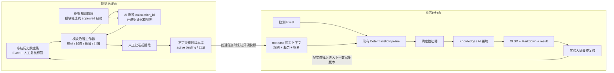

> 文档状态：历史归档
> 不作为当前实现和验收依据。
> 当前有效说明以 README、三份主指导文档及现行下一阶段架构为准。

# BambooWorkbench `moisture` 下一阶段架构设计

> 文档状态：Proposed（待模块负责人、框架负责人和业务负责人共同评审）
>
> 当前兼容基线：BambooWorkbench `module/moisture`，`modules/moisture` v0.1.2
>
> 目标：不重写含水率公式、Excel 解析、现有统计和中央任务合同，建设受治理的规则生命周期、任务规则快照、AI 受控编排与人工复核闭环。

## 1. 已冻结的设计结论

1. 采用“规则治理面 + 业务运行面”双平面架构。
2. 两个平面只通过不可变、已批准且可校验哈希的规则包连接。
3. AI 不能生成自由阈值、表达式或 Evaluator 代码，只能选择模块确定性程序生成的 `calculation_id`。
4. 框架不复制 moisture 的公式、统计、scope 匹配、规则编译或回放算法。
5. 框架不得直接 import 模块内部 Python；治理能力通过独立、版本化、文件协议的模块治理工作器调用。
6. 日常 `run_module.bat`、draft 和 finalize 始终只读，不承担规则发布或经验编辑。
7. 发布/回滚只影响之后创建的任务；进行中任务固定原规则快照。
8. Provider、Knowledge 或 AI 不可用时，确定性 XLSX、Markdown 和 result 仍须生成。
9. 业务方向已确认：下一业务版本停止生成红/蓝，AI 只提供非结论性分析，不改变19列主表的确定性橙/绿。当前 v0.1.2 和历史结果保持只读兼容；该行为变更由模块实现并单独验收，不由框架重写。
10. 当前 `0.47/0.55` 机器规则状态与业务文档状态不一致。在业务负责人处理前，不得自动迁移为新治理系统中的 approved active 版本。

## 2. 总体架构



### 2.1 权限与写入边界

- 规则治理存储位于框架数据根目录，不写应用安装目录或 `modules/moisture/rules/active/`。
- 只有框架发布服务能够写不可变规则版本并原子切换 active binding。
- 模块治理工作器读取框架提供的工作目录，将结果原子写入指定响应路径，不直接访问框架数据库。
- 日常任务、AI 网关和 Knowledge 服务只有读取任务快照的权限。
- 人工复核不修改原始 Excel、既有 artifacts、经验或已发布规则。

## 3. 模块治理工作器合同

### 3.1 独立入口

下一阶段由模块提供独立治理入口，不加入 `run_module.bat`。源码开发时使用仓库 `.venv`，便携交付时由框架调用模块随包提供的治理可执行文件。框架通过模块私有能力文件发现入口，不依赖目录名或硬编码 Python import。

建议模块私有能力文件：

```json
{
  "schema_version": "1.0",
  "module_id": "moisture",
  "governance_worker": "BambooMoistureGovernance.exe",
  "governance_protocol": "moisture-governance/1.0",
  "runtime_context_protocol": "moisture-runtime-context/1.0"
}
```

该文件不是中央 Module Manifest，不能改变现有 `module.json` Schema。未声明能力的旧模块不得收到扩展运行配置，也不得显示规则治理按钮。

### 3.2 操作集合

首期治理协议只包含以下有界操作：

| operation | 输入 | 输出 |
| --- | --- | --- |
| `validate_dataset` | 数据集 manifest、文件目录、标签 | 校验结果、文件哈希、拒绝原因 |
| `compute_statistics` | 已冻结数据集 | 确定性统计快照 |
| `build_catalog` | 统计快照、治理策略 | 有限候选计算目录 |
| `compile_proposal` | 候选目录、AI提案 | 当前 RuleDefinition 兼容候选集 |
| `replay` | 数据集、候选集、旧规则包 | 回放指标、差异和冲突报告 |
| `build_package` | 已通过回放的候选集、批准记录 | 待发布规则包；不切换 active |

调用形式为：

```text
<governance-worker> --request <absolute-request.json> --response <absolute-response.json>
```

协议要求：

- request/response 均为 UTF-8 JSON，`additionalProperties=false`；
- request、response、输入目录和临时文件必须位于框架为本次治理操作创建的工作目录；
- stdout 只允许进度 JSON，stderr 记录不含敏感原文的诊断；
- response 先写临时文件，完整校验后使用 `os.replace`；
- exit `0` 表示产生合法响应，exit `2` 表示请求/业务校验失败，exit `3` 表示内部故障；
- 即使 exit 非零，也不得修改 active binding 或历史版本；
- 框架负责超时、取消和进程隔离，模块负责业务输入输出校验。

## 4. 受控历史数据与确定性统计

### 4.1 数据集版本

一个 `HistoricalDatasetManifest` 至少保存：

- dataset ID、版本和父版本；
- 历史 Excel 只读副本的稳定相对路径、大小和 SHA-256；
- 批次与人工复核标签映射及其 SHA-256；
- 材料、供应商、季节、指标和时间范围；
- 创建操作人、创建时间、来源说明和标签口径版本；
- 规范化 manifest 和全部文件哈希计算出的整体 SHA-256。

发布后的数据集不可原地修改。文件、标签、范围或口径变化必须创建新版本。`confirmed_normal` 和 `confirmed_anomaly` 参与混淆矩阵；`retest_required` 和 `inconclusive` 只计入覆盖率。

### 4.2 统计定义

跨批次首期只分析批次级 `mean` 和 `range_value`，复用模块既有 Excel 解析、公式复核和批次统计，全部使用 `Decimal`。

每个 scope 输出 count、min、max、mean、median、P1/P5/P10/P25/P50/P75/P90/P95/P99、Q1、Q3、IQR、MAD、scaled MAD、缺失数、标签覆盖率和数据时间范围。

为保证跨机器复现，分位数固定采用线性插值：排序后 `h=(n-1)×p`，在 `floor(h)` 与 `ceil(h)` 之间按 Decimal 比例插值；Q1/P25、P50/median、Q3/P75 必须一致。scaled MAD 固定为 `MAD × Decimal("1.4826")`。中间计算不量化，序列化时使用无指数、无多余尾零的十进制字符串。

时间留出集默认取按业务日期、文件指纹稳定排序后的最后 20%；相同日期按文件 SHA-256 排序。若日期未解析或样本量不足，则只允许全量影子回放，并明确标记不能发布。

最低样本量、最大误报率和最低召回率必须由业务治理策略明确提供。未配置时允许统计、候选和影子回放，但禁止批准和发布。

### 4.3 候选计算目录

程序生成有限候选：

| 指标 | 方向 | 首期方法 |
| --- | --- | --- |
| `mean` | low/high | P5 / P95 |
| `mean` | low/high | Q1−1.5×IQR / Q3+1.5×IQR |
| `mean` | low/high | Median±3×1.4826×MAD |
| `range_value` | high | P95 |
| `range_value` | high | Q3+1.5×IQR |
| `range_value` | high | Median+3×1.4826×MAD |

每项包含 `calculation_id`、metric、direction、Decimal value、method、scope、statistics hash、sample count 和 limitations。`calculation_id` 由上述业务字段的规范化 JSON SHA-256 生成，不含时间、绝对路径、UUID 或模型输出。

## 5. 规范化与哈希

治理协议统一采用以下规则：

1. UTF-8、无 BOM、LF 换行；
2. JSON object 键按 Unicode 码点升序；
3. 无无意义空白；
4. Decimal 以规范十进制字符串保存；
5. 时间统一为 UTC RFC 3339，仅用于审计，不进入确定性 ID；
6. 文件使用稳定相对路径，禁止绝对路径、`..`、junction 和 symlink；
7. 数组在业务有序时保留顺序，无序集合在哈希前按稳定 ID 排序；
8. SHA-256 使用规范化 JSON 字节及 manifest 指定顺序的文件哈希计算。

规范化算法必须有版本字段和黄金向量测试；算法版本变化必须生成新数据集/统计/候选版本，不能覆盖旧哈希。

## 6. AI规则提案与证据边界

AI 输入仅包括候选计算目录、业务限制、框架已验证的 Knowledge 快照，以及模块治理工作器筛选出的 approved 经验有界摘录。

经验是否 approved、是否在有效期、是否匹配材料/季节/供应商 scope，由模块判断；框架只保存和运输模块产生的证据包，不重新实现经验适用性。

`RuleProposalResponse` 只允许：

- 选择已知 `calculation_id`；
- 引用已知 scope 和 evidence ref；
- 给出理由、限制和“继续回放/证据不足”的建议。

Schema 不包含自由阈值、表达式、代码或正式合格/不合格结论。未知候选、未知证据、未知字段和自由数值全部拒绝。AI文本始终视为不可信辅助内容；结构、引用、长度和禁止字段可以确定性校验，但不宣称能仅靠关键词完全识别所有越权语义。

## 7. 回放、审批、发布和回滚

回放复用当前 RuleDefinition 和 Evaluator 语义，不建立第二套判断算法。报告至少包括全量/留出集命中、scope 覆盖、混淆矩阵、误报率、召回率、无标签/复测/无法判断数量、旧新差异、逐条候选影响记录，以及数据集/候选/报告 SHA-256。

以下情况阻止批准：

- rule ID 冲突、上下限冲突或重叠 scope 下互斥；
- 未注册 Evaluator、未知字段或非法 operator；
- 数据集/候选哈希变化或回放未完成；
- 业务门槛未配置或未达到；
- 规则永不命中、覆盖全部样本或被完全遮蔽且没有业务负责人书面例外说明。

首期采用单人审批。桌面端仅记录本地审计操作人，不宣称具备强身份认证或角色授权。批准页面只能批准/拒绝；修改候选必须生成新版本并重新回放。

Phase 1 每个 module active binding 指向一个完整规则包，包内规则自行声明材料、季节和供应商 scope。框架不在 Excel 解析前按供应商选择规则。未来如确需多包，必须引入有稳定顺序和整体哈希的 package set 协议。

发布过程先写不可变版本目录，再校验 package/rules 哈希，最后以数据库事务或等价原子操作切换 active binding。失败时旧 active 保持不变。回滚只切换 binding，不修改或删除历史包。

## 8. 日常任务固定上下文

### 8.1 能力协商

当前 v0.1.2 的配置解析器只接受 `default_year`。框架只有在模块私有能力文件声明 `moisture-runtime-context/1.0` 后，才可生成扩展 `module_config_file`。旧模块、能力文件缺失或版本未知时，继续使用旧配置，禁止试探性下发未知字段。

扩展配置示例：

```json
{
  "config_schema_version": "2.0",
  "default_year": 2026,
  "rule_snapshot": {
    "path": "<task-local-absolute-path>/protocol/runtime-context/rules",
    "package_sha256": "<64-lowercase-hex>",
    "rules_sha256": "<64-lowercase-hex>"
  },
  "history_context": {
    "path": "<task-local-absolute-path>/protocol/runtime-context/history.json",
    "sha256": "<64-lowercase-hex>"
  }
}
```

路径必须位于 root task 内、是普通文件/目录且不得经过 symlink、junction 或 reparse point。Draft/Finalize 引用同一份只读配置和快照。快照被篡改时明确失败，不回退到当前全局 active。

### 8.2 多规则命中

现有解析、公式、统计和 Evaluator 保持不变。未来如增加多命中聚合，由模块实现并经业务验收：只高为偏高、只低为偏低、高低不同指标同时命中为人工确认、数据质量疑点优先、无命中为正常。所有命中仍保留 rule ID、字段、方向、版本和哈希。

下一业务版本的主表颜色仅保留确定性橙/绿。合法 AI 响应只能补充分析优先级、可能原因、复核步骤和证据引用，写入“模型分析记录”和 Markdown 的“AI辅助分析（非结论）”章节；不得把主表颜色升级为红/蓝。旧 result/XLSX 中已经形成的红/蓝保持原样，只读展示，不做历史回写。

## 9. Knowledge → AI 编排

中央 service 类型保持 `knowledge` 和 `ai`。依赖关系使用模块私有 AI payload 字段：

```json
{
  "dependencies": [
    {"service": "knowledge", "request_id": "<knowledge-request-id>", "required": false}
  ]
}
```

编排规则：

1. 框架先校验并执行依赖的 Knowledge request；
2. 每个请求仍在 `service-response.json` 中形成独立、原 request ID 的响应项；
3. 框架不修改模块原始 service request，而是为 Provider 构造临时 gateway payload；
4. gateway payload 可加入验证后的 Knowledge 项、模块提供的 approved 经验证据包和确定性趋势摘要；
5. Knowledge ref 采用 `knowledge:<record-id>:<version>:<sha256>`；
6. Finalize 将 AI evidence refs 与本次 Knowledge 响应、规则、经验和趋势哈希交叉校验；
7. `required=false` 时 Knowledge 失败仍可仅凭确定性候选执行 AI；`required=true` 时 AI 返回结构化 error，但任务继续确定性 finalize；
8. 用户拒绝联网、Provider 配置错误、HTTP 错误、限流和超时均形成 `denied`/`error`/`timeout` 响应，不抛出导致任务丢失的未处理异常。

## 10. 人工复核与数据生命周期

人工复核状态为 `confirmed_normal`、`confirmed_anomaly`、`retest_required`、`inconclusive`。记录保存 job、batch、规则版本/哈希、AI报告哈希、审计操作人、时间、结论和说明。`confirmed_anomaly` 与 `retest_required` 要求说明。

复核记录只在用户显式创建下一数据集版本时才能被选入。不得自动生成经验、规则或责任结论。

框架还必须提供：

- 数据集大小/文件数限额和导入前空间检查；
- 数据保留期限和人工删除/归档策略；
- 被 published rule 引用的数据集和回放报告禁止物理删除，只能归档或标记停用；
- 数据库备份恢复与文件哈希复核；
- 导出包默认脱敏，不包含 API Key、绝对路径、客户原始日志或 Provider 原始响应。

## 11. 责任矩阵

| 能力 | moisture模块 | 主框架 | 业务负责人 |
| --- | --- | --- | --- |
| Excel、公式、统计、Evaluator | 负责 | 不解释 | 批准口径 |
| 治理工作器、候选、编译、回放 | 负责 | 隔离调用与存储 | 批准门槛/例外 |
| 数据集文件与审计元数据 | 校验业务内容 | 负责存储、权限、生命周期 | 确认来源和使用范围 |
| AI候选与运行分析Schema | 负责业务约束和校验 | Provider、同意、降级 | 批准外发范围 |
| 规则审批、发布、binding、回滚 | 提供可发布包 | 负责流程与原子切换 | 作出批准/回滚决定 |
| 任务规则快照 | 校验并只读使用 | 创建、固定和恢复 | 无 |
| 人工复核 | 定义业务字段 | 页面、存储和审计 | 作出复核结论 |

## 12. 分阶段实施

### A：协议与业务口径冻结

- 冻结21份历史文件、166个样本、公式差异0、1高1低19正常基线；
- 批准统计、规范化、哈希、治理工作器和运行上下文协议；
- 处理 `0.47/0.55` 的批准状态。

### B：模块离线治理内核

- 模块实现治理工作器、统计、目录、编译、回放和冲突检查；
- 只允许试算/影子回放，不具备发布权限；
- 验证确定性、未知候选/证据/Evaluator拒绝和路径隔离。

### C：框架治理与任务快照

- 框架实现治理存储、页面、审计、发布、active binding、回滚和能力协商；
- 运行中任务固定旧版本，新任务使用切换后的版本；
- 无能力声明的旧模块保持原行为。

### D：服务编排、颜色迁移与人工复核

- 实现 Knowledge→AI 依赖编排、结构化降级、复核队列和数据集反馈选择；
- 模块在下一业务版本停止生成红/蓝，新增旧结果兼容和橙绿不被 AI 改色的回归测试；
- 框架只展示模块结果，不把旧红/蓝重算为橙/绿，也不根据 AI 文本自行着色。

### E：试点与回滚演练

- 完成历史影子回放和有限范围试点；
- 演练服务离线、发布中断、数据库恢复和规则回滚；
- 回归合同、公式、19列主表、Draft/Finalize及源码/便携运行。

## 13. 上线前阻塞决策

1. `0.47/0.55` 批准、撤销或转候选；
2. 各 scope 最低样本量、最大误报率和最低召回率；
3. 四种人工复核状态及其与“不合格/责任”的边界；
4. scope 优先级和样本不足回退策略；
5. Knowledge、经验和趋势摘要外发范围及审计保留期限；
6. 本地单人审批是否满足试点治理要求；
7. 红/蓝取消的目标模块版本、历史结果展示文案和升级说明。

对应框架请求见：[`../framework-change-requests/FCR-moisture-20260721-rule-governance-runtime-analysis.md`](../framework-change-requests/FCR-moisture-20260721-rule-governance-runtime-analysis.md)。
