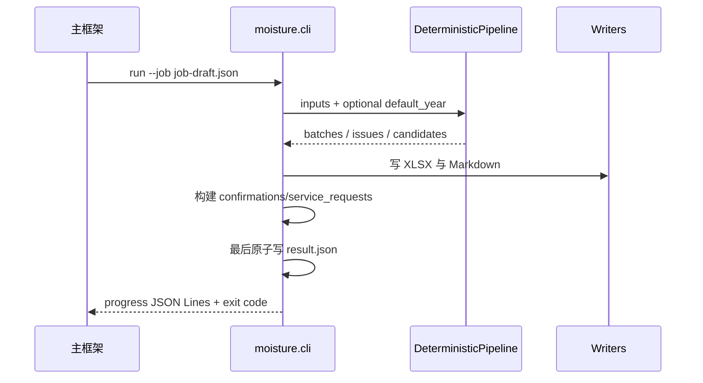

# 竹丝水分模块架构与开发维护指南

本文档是竹丝水分模块 `moisture` v0.1.0 的架构说明和开发维护参考，覆盖模块定位、分层设计、调用链、合同模型、两阶段流程、协议、经验库边界、规则扩展、测试命令、禁止事项、启动器优先级和便携构建。

> 业务流程、公式、阈值和颜色语义等业务口径请参见《业务规则与数据说明》。验收清单和已知限制请参见《验收标准与已知限制》。

---

## 1. 模块定位与系统上下文

竹丝水分模块不是独立桌面应用，也不承担主框架的身份、数据库、网络 Provider 或 UI 职责。它是一个由主框架通过进程合同调用的离线业务模块。

主框架与模块之间只通过文件（job.json、result.json、确认/服务响应文件）、stdout JSON Lines、stderr 和退出码通信。模块不依赖主框架进程内存，不直接访问主框架数据库。

```mermaid
flowchart LR
    U["用户 / 主框架 UI"] --> TS["TaskService"]
    TS --> SS["输入快照与任务目录"]
    SS --> J["JobRequest / job.json"]
    J --> REG["ModuleRegistry"]
    REG --> RUN["ModuleProcessRunner"]
    RUN --> BAT["modules/moisture/run_module.bat"]
    BAT --> CLI["moisture.cli"]
    CLI --> D["draft_orchestrator"]
    CLI --> F["finalize_orchestrator"]
    D --> OUT["result.json + XLSX + Markdown"]
    F --> OUT
    D --> SR["confirmations / service_requests"]
    SR --> HOST["主框架确认、Knowledge、AI 编排"]
    HOST --> RESP["confirmation / service-response 文件"]
    RESP --> F
```



### 部署信息

| 项目 | 当前值 |
|---|---|
| 模块 ID | `moisture` |
| 版本 | `0.1.0` |
| Manifest | `module.json` |
| 入口 | `run_module.bat` |
| Python 包 | `src/moisture/` |
| 输入扩展名 | `.xlsx` |
| 单文件/批次 | 均支持 |
| 增量运行 | 不支持（`supports_incremental=false`） |
| 网络要求 | `false`（`requires_network=false`） |

---

## 2. 模块目录结构

```text
modules/moisture/
├── module.json                 主框架 Manifest
├── run_module.bat              Windows 进程入口
├── requirements.txt            锁定范围的运行依赖
├── pyproject.toml              Python 包元数据
├── build_portable_runtime.ps1  便携运行时构建钩子
├── schemas/                    官方合同 Schema 副本与锁
├── rules/active/               只读运行时规则包
├── experience/                 运行时 approved 经验及离线治理文件
├── samples/protocol/           脱敏协议示例
├── templates/                  Markdown 报告模板
├── tools/                      合同同步工具
├── src/moisture/
│   ├── cli.py                  version / self-check / run 命令
│   ├── contract/               Job / Result / 确认 / 服务响应合同适配
│   ├── domain/                 公式、统计、规则、业务模型
│   ├── adapters/               Excel、规则、经验实现
│   ├── application/            draft / finalize 与请求/响应编排
│   ├── reporting/              XLSX、Markdown、输出校验
│   ├── infrastructure/         hash、路径、完整性、原子写入
│   ├── ports/                  窄接口定义
│   └── tools/                  离线经验管理 CLI
├── tests/                      unit / contract / integration / framework / acceptance
└── docs/                       业务、架构、验收和迁移证据
```

---

## 3. 分层架构

依赖方向保持为应用层依赖领域和 ports，adapters 实现 ports。正式运行入口不能 import 经验管理端。

| 层 | 主要组件 | 职责 | 不承担的职责 |
|---|---|---|---|
| 进程入口 | `run_module.bat`、`cli.py` | 选择受控 Python、解析命令、读取 Job | 安装依赖、调用网络 |
| 合同适配 | `contract/*` | 校验 Job、确认、服务响应，映射正式 Result | 修改官方 Schema |
| 应用编排 | `draft_orchestrator.py`、`finalize_orchestrator.py` | 调用确定性管线、生成请求、写 artifacts | 保存隐藏会话状态 |
| 领域 | `domain/*` | 水分公式、统计、规则与复核状态 | UI、数据库、Provider |
| 适配器 | `adapters/*` | Excel、规则包、经验库落地实现 | 主框架生命周期 |
| 报告 | `reporting/*` | 五表 XLSX、图表、Markdown | 正式责任结论 |
| 基础设施 | `infrastructure/*` | SHA-256、去重、路径、输入完整性、原子写 | 在线存储 |

---

## 4. 调用链

### 正式运行调用链

```text
BambooWorkbench GUI
  → ModuleRegistry（默认扫描正式 modules/）
  → TaskService（输入快照、draft/finalize）
  → ModuleProcessRunner
  → modules/moisture/run_module.bat
  → BambooMoistureModule.exe（便携运行时）或仓库 .venv Python（源码开发）
  → result.json + moisture_summary.xlsx + analysis_report.md
```

普通启动默认发现并调用正式 `modules/moisture`，只有显式传入 `--demo` 时才使用演示模块。

### CLI 命令

正式任务由主框架创建符合 JobRequest Schema 的绝对路径 `job.json`，然后调用：

```powershell
modules\moisture\run_module.bat version
modules\moisture\run_module.bat self-check
modules\moisture\run_module.bat run --job C:\absolute\path\to\job.json
```

`run --job` 支持单文件和批次。进度以 JSON Lines 写入 stdout，普通诊断写入 stderr。模块不依赖当前工作目录。

---

## 5. JobRequest 与 ModuleResult 合同模型

模块与主框架之间通过正式合同 Schema 定义的 JSON 文件交换数据。Schema 的官方副本及其锁文件位于 `modules/moisture/schemas/`，由 `contracts/schemas/` 同步而来。机器 Schema 不因旧测试或旧实现而修改。

### 外部接口

模块的外部接口仅包括：

- `module.json`（模块 Manifest）
- `run_module.bat`（进程入口）
- `version`、`self-check`、`run --job` 命令
- 协议文件（job.json、confirmation bundle、service response file）
- stdout JSON Lines、stderr、退出码
- output artifacts（result.json、moisture_summary.xlsx、analysis_report.md）

模块不 import 主框架内部 Python 代码，不共享 DTO、数据库、回调或 HTTP 服务。

### JobRequest 核心约定

- 输入为 job 明确列出的 `.xlsx` 输入副本，不扫描用户磁盘
- 所有输入与输出路径先 resolve，再验证位于 job 授权范围
- 文件名以 `~$` 开头的 Excel 临时文件必须跳过
- 文件内容身份使用 SHA-256；绝对路径、output_dir、执行时间和随机 UUID 不参与业务身份
- 内容完全相同的多个文件只计算第一次出现的文件，其余形成稳定的 `info/skipped` 记录

### ModuleResult 核心约定

result.json 包含：

- `job_id`：draft 使用当前 job.job_id，finalize 使用当前 finalize job_id（稳定业务 ID 使用 `parent_job_id`）
- `status`：`success`、`partial_success`、`needs_confirmation`、`failed`
- `outputs`：正式 artifact 列表
- `confirmations`：draft 的业务确认项（finalize 为空）
- `service_requests`：至多一个 knowledge request 和一个 AI request（finalize 为空）
- `errors`：结构化错误列表
- `analysis_summary`：业务摘要文本

### 状态与退出码

状态只能由集中 mapper 计算，CLI、orchestrator 和 writer 不得各自维护一套规则。

| 情况 | 状态/退出码 |
|---|---|
| 合法 success/partial/needs_confirmation 结果 | exit 0 |
| 合法 failed 结果 | exit 0 |
| 非法 CLI、job JSON 或任务合同 | exit 2 |
| 内部崩溃或无法形成/写入合法 result | exit 3 |
| 依赖、模板、规则包或运行环境缺失 | exit 4 |

业务失败不等于进程失败。

---

## 6. draft/finalize 两阶段流程

### 6.1 确定性业务管线

`DeterministicPipeline` 对输入按顺序执行：

1. 跳过 `~$*.xlsx` Office 临时文件
2. 计算内容 SHA-256，并按内容指纹去重
3. `FileIntegrityGuard` 在解析前后复核输入未改变
4. 动态识别工作表、表头和 1--10 个有效样本
5. 读取供应商、材料、到货/检测日期、总重、部门和质量数据
6. 独立复算含水率，使用既有容差判断公式一致性
7. 计算均值、极值、区间、标准差、中位数、四分位数及部门差
8. 加载只读规则包并按机器资产中的 `confirmed` 状态评估适用规则；机器状态与当前业务审批状态的差异见《验收标准与已知限制》
9. 保留经验引用字段，供受控的经验检索结果附加
10. 形成批次、异常、候选、文件结果和错误列表

单个损坏文件只影响自身。批次可形成 `success`、`partial_success` 或 `failed`，不会因为单文件错误丢弃其他成功结果。

### 6.2 draft 流程



draft 可能产生：

- 真实业务 confirmations
- 至多一个 Knowledge request
- 至多一个 AI request
- 确定性 XLSX、Markdown 和 result

确认和 request ID 基于 root job ID、文件内容指纹、字段、候选、规则 hash 等稳定数据，不依赖 UUID、时间、绝对路径或 finalize job ID。

### 6.3 draft 状态裁决

- 所有可处理文件成功：`success`
- 至少一份成功且至少一份失败：`partial_success`
- 无任何可用业务结果：`failed`
- 基础状态为 failed 时保持 failed，不为调用服务制造请求
- 有模块业务 confirmations 时为 `needs_confirmation`
- 无模块 confirmations、仅有 service_requests 时保持基础 success/partial_success
- `confirmation_count` 只统计模块生成的 prompts；宿主注入的 AI 授权项由宿主负责
- knowledge-only 可由框架自动 finalize；AI consent 等待态可由宿主规范化

### 6.4 finalize 流程

finalize 是新的独立进程：

1. 当前 result 使用 finalize 自身 `job_id`
2. 使用 `parent_job_id` 作为 root identity
3. 从当前输入重新运行完整确定性管线
4. 不读取 draft 输出目录、不依赖前一进程内存
5. 重建相同 confirmation/request ID
6. 严格校验确认答案、候选值、类型和批量应用语义
7. 严格绑定服务 response 的 request、candidate、direction、field、value、rule hash、confidence 和 evidence
8. 合法证据才可升级复核显示状态；无效、拒绝、错误、超时或缺失响应安全降级
9. 最终结果中的 confirmations 和 service_requests 均为空

### 6.5 finalize 状态裁决

- 重新执行与 draft 相同的确定性管线，不依赖 draft 内存或隐藏数据库
- `result.job_id` 使用当前 finalize `job.job_id`；稳定业务 ID 使用 `parent_job_id`
- finalize 输出的 confirmations 和 service_requests 必须为空

---

## 7. confirmations 与 service requests 协议

### 7.1 confirmations

confirmations 的生成范围：

- 只为水分解释、年份/sheet 歧义、供应商/部门映射、公式冲突和 pending 规则适用性生成确认
- 不生成身份、密码、Provider、网络、API Key 或责任结论确认
- 可确定性读取或计算的 Excel 内容不生成确认

confirmations 的身份与生命周期：

- draft 根身份为当前 `job.job_id`；finalize 根身份为 `job.parent_job_id`
- 稳定 confirmation ID 为 `msr-confirm-<SHA256前24位>`，不得依赖 finalize 自身 job_id、绝对路径、时间或 UUID
- draft 存在模块业务 confirmations 时模块原始状态为 `needs_confirmation`
- finalize 只重建并应用 draft 确认，不生成新 confirmation

### 7.2 条件协议文件

- `confirmation_file` 仅在 draft 产生模块业务 ConfirmationPrompt 或 `requires_user_consent=true` 的 AI request 时必需
- 无确认需求时允许该字段为 null；当前框架若提供空 bundle，模块接受并校验
- confirmation bundle 的 job_id 必须等于 root_job_id
- `service_response_file` 仅在重建出的 draft service_requests 非空时必需
- 有请求但 service file 缺失、不可读或非法时，为预期请求产生降级记录，不丢失确定性成果
- 无服务请求时意外提供 service file 不得改变结果

### 7.3 service requests（Knowledge 与 AI）

模块只声明正式 `service_requests`，不直接调用服务。每个 job 最多一个 knowledge request 和一个 AI request，二者只在 draft 产生。

**Knowledge request：**

- `requires_user_consent=false`
- scope 优先 `moisture`，其次 `shared`；未授权 scope 不请求
- query 不超过 200 个 UTF-8 字节
- Knowledge 仅进入 Markdown 报告引用，不改变规则或颜色

**AI request：**

- `requires_user_consent=true`
- 最多 50 个候选；规范化 JSON payload 不超过 65,536 UTF-8 字节
- 候选按相对偏离度降序、同分 candidate_id 升序；超限从末尾移除；未发送候选保持橙/绿
- AI request ID 使用 root_job_id、module_id、服务类型和规则 hash，不包含候选摘要，也不得使用 finalize 当前 job_id
- payload 不包含完整 Excel、绝对路径、客户身份、原始行、API Key 或无边界历史

模块不持有 Provider、HTTP 客户端、API Key 或重试逻辑。主框架当前默认使用 `MockProvider`。是否接入真实 API 是主框架和安全负责人的职责。

### 7.4 服务响应校验与降级

finalize 对 request ID、候选 ID、方向、字段、观测值、rule hash、evidence 和置信度逐项校验：

- 只有 request ID、rule hash、candidate ID、direction、field、observed value 全部匹配，decision 合法、evidence 非空且 `confidence >= 0.80` 时，AI 证据才可提升辅助复核状态
- `denied`、`error`、`timeout`、missing、invalid envelope、非法业务 JSON 和 MockProvider 普通文本均保留确定性筛查结果
- 服务失败通过顶层 errors、analysis_summary 和"模型分析记录"呈现，不自动把基础 success 改为 partial_success
- 服务降级不得丢失已完成的本地确定性统计和 artifacts
- finalize 不发起第二轮请求或确认
- 服务完全不可用时仍必须输出确定性 XLSX、Markdown 和 result

---

## 8. 经验库运行时只读与离线管理边界

经验库分为两个严格隔离的边界：

### 8.1 正式运行时（只读）

`LocalApprovedExperienceRepository` 提供只读查询实现，查询时只返回：

- `approved` 状态
- 在有效期内
- scope 与供应商、材料、季节、指标匹配
- manifest hash、Schema 和治理关系合法

正式运行边界只允许读取经验库。运行时接线必须保持只读。查询故障只产生降级提示，不破坏确定性输出。

### 8.2 离线管理端

`LocalEditableExperienceRepository`、`ExperienceManagementService` 和 `moisture.tools.manage_experience` 支持：

```text
list / show / validate / create / update / publish / retire
```

生命周期为 `draft → approved → retired`。管理端实施版本冲突、expected hash、Schema、路径越界、原子写入和历史保留。approved 不可原地修改，retired 保留历史文件。

正式运行不得 import 经验管理端。经验治理命令仅离线使用：

```powershell
$env:PYTHONPATH = (Resolve-Path "modules\moisture\src").Path
.\.venv\Scripts\python.exe -m moisture.tools.manage_experience --root modules\moisture\experience list
```

管理端没有 Web、登录、多人审批或在线发布平台。

---

## 9. 规则扩展方法

### 运行时规则包

运行时规则位于 `rules/active/`，由 `RulePackageLoader` 只读加载并校验：

- Schema 合法性
- 内容 hash 完整性
- 来源与版本
- 批准状态（只有 `confirmed` 规则可自动判定；`pending_confirmation` 规则只能生成确认或说明）

规则包含编号、版本、来源、适用范围、规则文件 hash 和客户确认状态。expected results 只位于 `tests/fixtures/rule_packages/`，不得进入 runtime rules。

### 扩展点

evaluator registry 是新增规则类型的唯一窄扩展点。新增规则类型时：

1. 在 evaluator registry 中注册新的 evaluator 实现
2. 对应的规则包增加新的规则条目（含编号、版本、来源、适用范围、hash 和确认状态）
3. 在 `tests/fixtures/rule_packages/` 中增加 expected results
4. 经负责人批准后将规则状态变更为 `confirmed`

不建设通用插件平台或运行时发布服务。规则包运行时只读，runtime 目录只包含 `rule-package.json` 和 `rules.yaml`。

### 规则包变更检测

draft/finalize 规则 hash 不一致时，finalize 拒绝处理：

- `status="failed"`，退出码 0
- `outputs=[]`、`confirmations=[]`、`service_requests=[]`
- 顶层 errors 包含 `RULE_PACKAGE_CHANGED_DURING_TASK`
- analysis_summary 记录当前规则版本/hash、无法复现的 ID 类型和重新创建任务建议

---

## 10. 输出与原子性

### 正式 artifacts

成功或部分成功任务可生成以下五张固定工作表（名称和顺序由 `workbook_validation.py` 锁定）：

- `moisture_summary.xlsx`：
  - **竹丝含水率统计**（20列）：序号、供应商、材料类型、到货日期、检测日期、样本1—10、最大值、最小值、区间值、均值、筛查结果 —— 面向业务的精简主表，技术列统一路由到明细表；
  - **异常分析明细**（8列）：批次编号、供应商、检测日期、目标字段、观测值、筛查结果、原因、复核建议；
  - **趋势分析**（14列）：序号、批次编号、检测日期、供应商、均值、区间值、初筛下限、初筛上限、标准差、中位数、第一四分位数、第三四分位数、四分位距、部门均值最大差；
  - **来源追溯**（12列）：批次编号、来源文件、文件哈希、来源工作表、样本行、总重、样本部门映射、规则版本、规则SHA-256、规则适用范围、规则确认状态、经验引用；
  - **模型分析记录**（8列）：批次编号、初筛状态、AI复判状态、置信度、最终显示色、人工确认状态、AI理由、降级原因；
- `analysis_report.md`：业务摘要、规则状态、经验引用、AI 声明和错误说明
- `result.json`：正式机器合同结果

主表展示规则：
- 材料类型统一显示为"原竹丝"（展示层归一化，不修改源文件或 parser）；
- 筛查结果仅显示四种中文文字（正常/偏高疑似/偏低疑似/需人工确认）；
- 日期统一 `yyyy-mm-dd`，百分比 `0.00%`，不存在的样本单元格为 Excel 空白（非0或空串）；
- 冻结 `F2`（标题行和前五列），筛选范围 `A1:T1`；
- `final_display_color` 颜色写入"筛查结果"单元格，命中主表指标时同时保留指标底色。

### 原子写入

固定写入顺序：

1. output_dir 内写临时 XLSX，关闭并校验后 `os.replace` 为正式 XLSX
2. output_dir 内写临时 Markdown，校验并原子替换为正式 Markdown
3. 只登记真实存在且位于 output_dir 的正式 artifacts
4. 构造并用受锁 Schema 副本校验 ModuleResult
5. flush/fsync 临时 JSON 后 `os.replace` 为 `result.json`
6. result 成功后才发出 100% progress

result 写入失败时退出 3；半成品不得被 result 引用或被框架登记。

---

## 11. 安全与故障隔离

模块实施以下安全与隔离措施：

- output_dir containment 与路径越界拒绝
- 输入读取前后 SHA-256 完整性验证
- 临时文件、重复文件和坏文件隔离
- stdout 只允许版本输出或 `ProgressEmitter` 的 JSON Lines；日志与 traceback 只进入 stderr
- 超时、取消、进程失败不写伪成功 result
- 模块不得修改、重命名、移动或删除输入文件
- 单文件失败使用稳定错误码（例如 `WORKBOOK_STRUCTURE_INVALID`、`WORKBOOK_STRUCTURE_AMBIGUOUS`、`SAMPLE_LIMIT_EXCEEDED`、`SOURCE_FILE_MODIFIED`）
- 无 FastAPI、Uvicorn、Web、身份、Session、Cookie、CSRF、数据库、HTTPX、Provider、API Key 和网络发布服务
- 提交和交付包不得包含客户原始 Excel、真实供应商身份、绝对路径、运行日志、缓存或凭据

---

## 12. 测试架构

| 测试层 | 重点 |
|---|---|
| unit | 公式、统计、规则、经验、请求构建、响应校验 |
| contract | Manifest、CLI、Schema lock、禁止依赖、管理边界 |
| integration | Excel、批次、draft/finalize、报告、降级 |
| framework | Registry、Runner、TaskService、路径、超时、取消 |
| acceptance | 脱敏业务样本、公式关键值、报告标记和协议示例 |

---

## 13. 常用命令

所有开发和测试命令必须显式使用 BambooWorkbench 仓库的虚拟环境。从仓库根目录执行。不得使用裸 `python`、`py`、系统 Python 或全局安装的依赖。

### 环境验证

```powershell
.\.venv\Scripts\python.exe -c "import sys; print(sys.executable); print(sys.version)"
.\.venv\Scripts\python.exe -m pytest --version
```

### 安装依赖

```powershell
.\.venv\Scripts\python.exe -m pip install -r modules\moisture\requirements.txt
```

### 合同校验

```powershell
.\.venv\Scripts\python.exe -m app.tools.module_contract_cli validate modules/moisture
```

### 运行测试

```powershell
.\.venv\Scripts\python.exe -m pytest modules\moisture\tests -q
```

### 模块自检

```powershell
modules\moisture\run_module.bat version
modules\moisture\run_module.bat self-check
```

### 仓库门禁

```powershell
powershell -ExecutionPolicy Bypass -File scripts\verify_repo.ps1
```

### 通过主框架 GUI 测试

```powershell
.\.venv\Scripts\python.exe -m app
```

普通启动默认发现并调用正式 `modules/moisture`；只有显式传入 `--demo` 时才使用演示模块。

### 离线经验管理

```powershell
$env:PYTHONPATH = (Resolve-Path "modules\moisture\src").Path
.\.venv\Scripts\python.exe -m moisture.tools.manage_experience --root modules\moisture\experience list
```

---

## 14. 禁止修改目录与禁止依赖

### 禁止修改的目录

模块开发中不得修改以下目录中的任何文件：

- `app/` —— 主框架应用代码
- `core/` —— 主框架核心库
- `ui/` —— 主框架 UI 组件
- `contracts/` —— 官方合同 Schema（只读引用，模块自有副本在 `modules/moisture/schemas/`）
- `.github/` —— CI 配置
- `scripts/` —— 主框架构建与验证脚本

框架缺陷只记录，不在模块分支修复。

### 禁止依赖

模块代码不得引入以下能力：

- GUI（桌面或 Web 界面）
- FastAPI、Uvicorn 或其他 HTTP 服务
- Identity、用户、密码、角色、Session、Cookie、CSRF
- 框架 SQLite、Windows 凭据或 API Key
- OpenAI/Azure/其他 Provider adapter、HTTPX gateway 或网络重试
- rules-ui、rules-user、运行时规则写入/发布
- 扫描用户磁盘、修改原始 Excel、越过 output_dir 写入
- 旧 JobConfig、旧 Job/Result Schema 或旧 Manifest 能力声明
- draft 隐藏状态、finalize 新 service_requests
- 网络访问（`requires_network=false`）

---

## 15. BAT 解释器优先级顺序

`run_module.bat` 按以下优先级选择运行时，不会从 PATH 盲选系统 Python：

1. `BAMBOO_MODULE_EXECUTABLE` —— 显式指定冻结 EXE（最高优先级）
2. `runtime\BambooMoistureModule.exe` —— 随模块交付的本地冻结程序
3. `BAMBOO_MODULE_PYTHON` —— 显式指定 Python 解释器
4. 已激活的 `VIRTUAL_ENV`
5. BambooWorkbench 仓库 `.venv`
6. 模块本地 `.venv`

源码开发环境必须显式使用仓库 `.\.venv\Scripts\python.exe`。

---

## 16. 便携运行时构建

### 概述

模块提供 `build_portable_runtime.ps1`，使用仓库 `.venv` 中的 PyInstaller 以 **onedir** 方式构建 `BambooMoistureModule.exe`。该钩子由主框架构建链调用，客户无需安装 Python 或任何依赖。

### 前置条件

- 仓库 `.venv` 存在且包含 Python 3.11+ 和 PyInstaller
- 主框架已通过 `scripts/build_portable.ps1` 生成 `dist/BambooWorkbench/modules/moisture/` 目录及 `module.json`

### 构建命令

由主框架 `scripts/build_real_module_runtimes.ps1` 调用：

```powershell
powershell -ExecutionPolicy Bypass -File modules\moisture\build_portable_runtime.ps1
```

### 产物位置

```text
dist/BambooWorkbench/modules/moisture/runtime/
```

### 构建行为

- 以原子替换方式更新运行时（`.runtime.incoming` → `runtime`，失败时回滚）
- 只清理本模块的构建工作目录和 portable 内的 `runtime/`，不触碰其他模块、用户目录或整个 `dist/`
- 每次构建后自动清理 `build/moisture-portable-runtime/`
- 冻结运行时内部包含 schemas、rules、experience、templates 及模块 CLI 及其 Python 依赖

### 不得提交

`.exe`、`runtime/`、`build/`、`dist/`、`.venv` 中的任何文件。

---

## 17. 外部事项

主框架接入、真实 Provider、治理入口、报告增强、阈值治理和正式发布签署等未完成事项，
统一记录在 [`framework-issues.md`](framework-issues.md)。本指南不重复维护另一份负责人清单。

---

## 附录：历史月度 Excel 兼容

历史标题、日期别名、`default_year` 和父目录年份推断属于业务输入规则，
统一以 [`业务规则与数据说明.md`](业务规则与数据说明.md) 的“历史月度工作簿兼容”章节为准。
